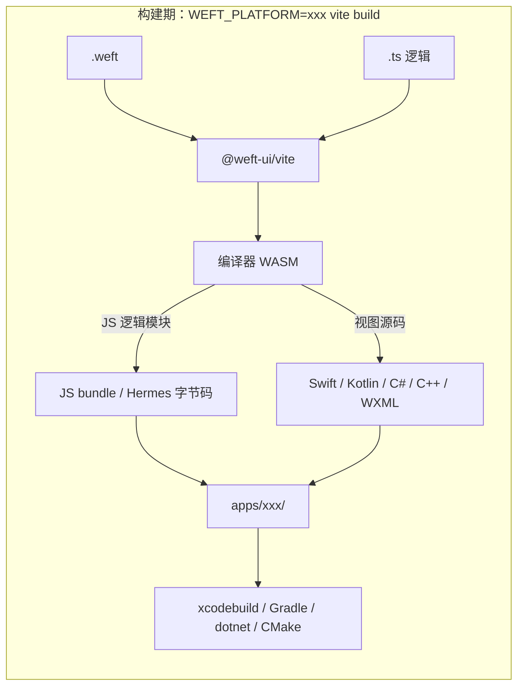
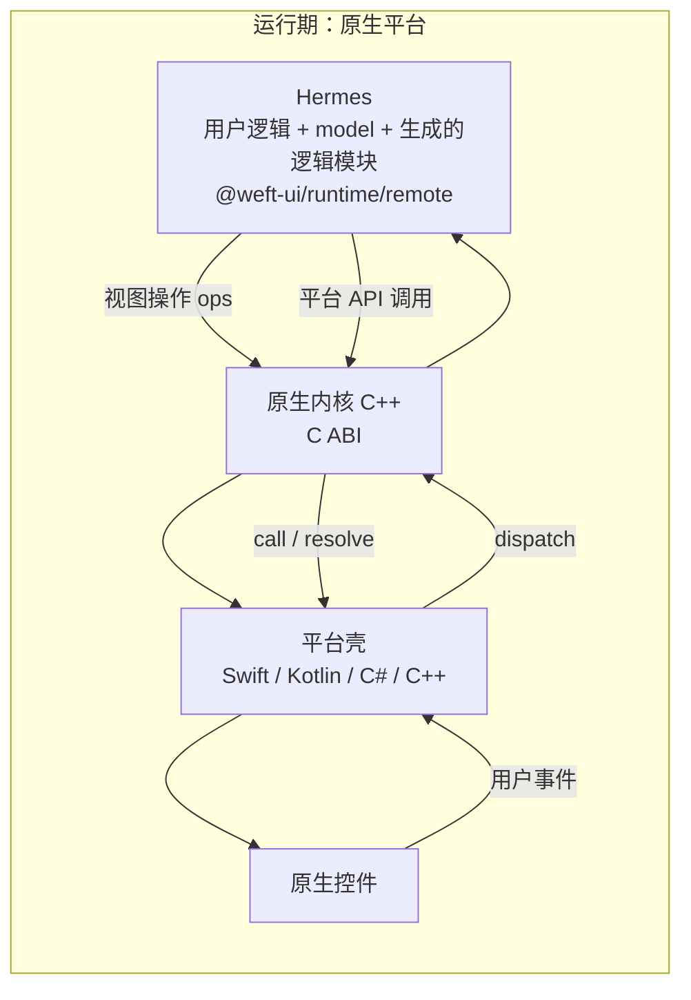
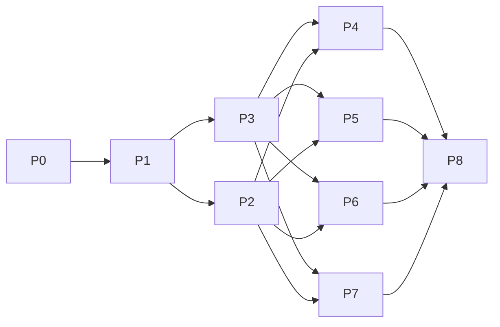

# PLAN v2：一套代码，所有平台

一份 `.weft` 视图加一份 JS/TS 逻辑，产出 7 个平台的原生应用：

| 平台      | 视图层                | 逻辑层 JS 引擎        | 宿主构建工具            |
| --------- | --------------------- | --------------------- | ----------------------- |
| `web`     | DOM                   | 浏览器                | 无（Vite 产物即成品）    |
| `wechat`  | WXML                  | 小程序逻辑层          | 无（可选调开发者工具 CLI） |
| `ios`     | SwiftUI               | Hermes                | `xcodebuild`            |
| `macos`   | SwiftUI               | Hermes                | `xcodebuild`            |
| `android` | Jetpack Compose       | Hermes                | Gradle                  |
| `windows` | WinUI 3（C#）          | Hermes                | `dotnet build`          |
| `linux`   | GTK 4（C++）           | Hermes                | CMake                   |

语言本身不变：语法见 [GRAMMAR.md](GRAMMAR.md)，单向数据流、`model` / `event` / `state` 语义、编译期依赖分析和脏位方案沿用 [PLAN.md](PLAN.md)。本文只描述新架构，以及从现状迁移过去的路线。

## 目标与非目标

目标：

- **视图原生**：每个平台的视图编译成该平台的原生控件代码，不用 WebView，也不自绘。
- **逻辑统一**：业务逻辑和数据只写一份 JS/TS。Web 和小程序用平台自带的引擎，其余平台嵌入 [Hermes](https://github.com/meta/hermes)，发布时预编译成字节码。
- **构建一条命令**：`WEFT_PLATFORM=xxx vite build` 生成 `apps/xxx/` 原生工程，然后调用宿主机的构建工具出包。
- **平台 API 统一**：`import { fetch } from "@weft-ui/platform"`。各平台的类型签名完全一致，不支持的 API 调用时抛错。

非目标：

- 不追求像素级一致。只保证布局语义一致（见[布局规范](#内置元素与布局规范)），外观贴近各平台原生风格。
- 不提供 JS 以外的逻辑层。现有的 Rust 宿主在 P0 删除（见[迁移](#从现状迁移)）。
- 第一阶段不做多页面导航、多窗口、平台特有元素，也不做原生端热更新。

## 总体架构





### 关键决策

| 决策         | 选择                                                         | 理由                                                         |
| ------------ | ------------------------------------------------------------ | ------------------------------------------------------------ |
| 绑定在哪求值 | 全部在 JS 逻辑层，推广小程序后端的做法。原生模板里没有表达式    | 表达式代码生成只有一份（JS），整除、`??`、字符串格式化等语义在所有平台一致；原生 codegen 只生成结构和槽位读取，工作量小一个数量级 |
| Web          | 继续直接操作 DOM，不走视图协议                               | 同一个线程里没必要多一层中转；现有 M2 的实现和更新粒度保持不变 |
| 视图协议     | 新增 `ViewLayout`，作为编译器核心概念（见[视图协议](#视图协议)） | 逻辑层和视图层的唯一契约。小程序和 4 个原生平台共用一份逻辑代码生成，差别只在“sink” |
| 原生内核     | C++ 实现，对外暴露 C ABI，用 CMake 构建                       | Hermes/JSI 本身就是 C++；Swift（C 互操作）、Kotlin（JNI）、C#（P/Invoke）、GTK 都能直接调用 C ABI |
| JS 线程      | 第一阶段 Hermes 跑在 UI 线程，事件同步分发、同步 flush         | 受控输入能当场决定是否回滚（和小程序一样）。协议仍保留 hold/ack，以后可以把 JS 挪到独立线程 |
| Apple        | iOS 和 macOS 共用一个 SwiftUI codegen，靠 `#if os()` 区分少量差异 | 两端控件和 Observation 模型相同                              |
| Windows      | C# + WinUI 3，用 `dotnet build` 构建                           | WinUI 3 在 C# 上支持最成熟，生成的代码简洁；通过 P/Invoke 调用内核 |
| Linux        | GTK 4。生成的 C++ 直接调用 GTK 的 C API，用 CMake 构建，和内核同一套工具链 | 不额外引入 gtkmm 或 Rust 工具链                              |
| 原生最低版本 | iOS 17、macOS 14、Android API 24、Windows 10 1809、GTK 4.10  | SwiftUI 需要 Observation（`@Observable`）；其余是 Compose、Windows App SDK、GTK 4 的稳定基线 |

## 编译器架构

### Crate 划分

```
crates/
  compiler/        weft-ui-compiler：syntax、sema、deps、IR，新增 view（ViewLayout）、
                   codegen（Codegen trait、Platform、OutputFile）
  codegen-js/      JS 宿主绑定（model 类、events、App 类、.d.ts）+ 表达式生成；
                   两种逻辑模式：dom（供 codegen-web 拼装）和 remote（输出视图协议 ops）
  codegen-web/     DOM 创建与 patch（现有 codegen/web 中 DOM 相关部分）
  codegen-wechat/  WXML + 视图组件（现有 wxml.rs / miniprogram.rs）
  codegen-swiftui/ iOS / macOS
  codegen-compose/ Android
  codegen-winui/   Windows（C#）
  codegen-gtk/     Linux（C++）
  driver/          Platform → 后端的分发、应用级编译入口；被 wasm 和测试使用
  wasm/            wasm-bindgen 导出 driver
```

依赖方向：`compiler` ← `codegen-js` ← `codegen-web` / `codegen-wechat`；原生后端只依赖 `compiler`；`driver` 依赖全部后端。编译器核心不知道有哪些后端。

### Codegen 接口

```rust
/// 目标平台；字符串形式与 WEFT_PLATFORM 一致。
pub enum Platform { Web, Wechat, Ios, Macos, Android, Windows, Linux }

pub struct Context<'a> {
    pub program: &'a Program,
    /// 非 web 平台由 compiler 从 IR 计算；web 为 None。
    pub layout: Option<&'a ViewLayout>,
    pub platform: Platform,
}

/// 生成一个平台的视图层。逻辑层固定由 codegen-js 生成，不属于这个接口。
pub trait Codegen {
    fn generate(&self, cx: &Context<'_>) -> Vec<OutputFile>;
}

/// 相对 apps/<platform>/weft/ 的路径和内容。
pub struct OutputFile { pub path: String, pub contents: String }
```

- `driver::compile_app(entries, platform, loader)` 返回 `{ logic: Vec<JsModule>, views: Vec<OutputFile>, layout_hash, diagnostics, files }`。`logic` 交给 Vite 的 `transform`，`views` 由插件写进原生工程。
- **应用级 Program**：原生端的模板注册表覆盖整个应用，所以非 web 平台把应用里所有 `.weft`（默认是 `src/` 下的全部文件）编译成一个 Program。导入闭包内名字唯一的规则扩大到整个应用。新增 `check_many(entries)`，现有的 `check(entry)` 是它的单入口特例。
- **布局哈希**：`ViewLayout` 的哈希同时写进 JS 逻辑和原生模板。内核启动时比对，不一致直接报错，避免 JS bundle 和原生工程版本错位、悄悄渲染错。
- 平台能力检查（例如以后的 `Ios.xxx` 命名空间元素）放进 `driver`：它知道目标平台，在 IR 上报诊断，不需要后端各自报错。

### 视图协议

`ViewLayout` 从 IR 推导，把每个组件拆成**块模板**：组件体、每个 `if` 分支、每个 `for` 行体、每个插槽内容各算一个模板，在应用内统一编号。

| 模板成员 | 内容                                                         |
| -------- | ------------------------------------------------------------ |
| 静态树   | 元素和静态属性。常量直接内联进原生模板，不占槽位              |
| 值槽     | 动态属性和文本：`(节点, 属性, 类型)`，类型是 `Int` / `Float` / `Bool` / `String` |
| 事件槽   | `(节点, 事件属性, 载荷类型)`。`Emit` 和 lambda 都在 JS 侧解析，原生端只回报“哪个 scope 的哪个槽被触发” |
| 挂载点   | `(节点, 种类)`，种类是 `Branch`、`List`、`Instance(组件)` 或 `Slot` |

运行时每个模板实例是一个 **scope**，id 由 JS 分配。每次 flush 产出一批 ops，一次调用交给 sink：

| op       | 参数                          | 含义                                                         |
| -------- | ----------------------------- | ------------------------------------------------------------ |
| `create` | scope, template               | 创建实例（此时还没挂上树）                                   |
| `set`    | scope, slot, value            | 写值槽                                                       |
| `branch` | scope, point, child \| 0      | `if` 切换。旧的子 scope 连同后代隐式销毁                     |
| `rows`   | scope, point, [child…]        | `for` 的完整新顺序。不在新列表里的行隐式销毁                 |
| `attach` | scope, point, child           | 组件实例 / 插槽内容，只在创建时发一次                         |

批内顺序保证新 scope 的 `create` / `set` 先于挂载它的 op，所以原生端总是先建好子树再插入。反方向只有一种消息：`dispatch(scope, handler, payload)`。

- **编码**：二进制、带版本号。JS 侧写进可复用的 `ArrayBuffer`，内核零拷贝交给平台壳；另提供调试用的文本 dump。小程序的 sink 不编码，直接把 ops 翻译成 `setData` 路径，数据形状保持 M4 的现状。
- **列表**：协议只给最终顺序。SwiftUI `ForEach(id:)` 和 Compose `key` 自己处理移动；WinUI 和 GTK 调用内核里的 LIS 工具算出最少的移动。
- **受控输入**：JS 在 UI 线程上同步执行 `dispatch` 和 flush，返回时原生端已经知道值有没有被接受，没接受就回滚。IME 组字期间不回滚，各平台都要实现这一点。
- **生命周期**：规则同 PLAN.md。在原生平台上，“插入渲染树”指 commit 已提交到原生控件树，由 JS 在 commit 返回后触发，不等同于 SwiftUI 的 `onAppear`（可见）。
- **无头渲染器**：`@weft-ui/runtime/testing` 把 ops 应用到一棵内存树上，作为协议的参考实现，所有一致性测试都基于它（见[测试](#测试策略)）。

P1 已按此实现，完整规范（布局 JSON、编码、根挂载、事件返回值）见 [PROTOCOL.md](PROTOCOL.md)。与上文的出入：值槽类型取元素属性的类型，目前只有 `Int` / `Bool` / `String`（数字统一按 f64 编码）；根组件实例挂在虚拟 scope 0 的挂载点 0 上（`attach 0 0 <id>`）；scope id 按 app 分配，保证同一脚本的 ops 日志与运行顺序无关。

### 两类视图后端

| 类别   | 平台                 | 生成内容                                                     |
| ------ | -------------------- | ------------------------------------------------------------ |
| 响应式 | SwiftUI、Compose     | 每个模板一个状态类（`@Observable final class` / `mutableStateOf` 属性）和一个视图函数；`apply(slot, value)` 是生成的 `switch`。框架只重组读到变化属性的视图，细粒度更新由框架完成 |
| 命令式 | WinUI、GTK（以及 DOM） | 每个模板一个类：构造时创建控件，持有需要更新的控件引用，`apply(slot, value)` 直接改控件属性。和现有 DOM 后端是同一种结构 |

两类共享同一个 `ViewLayout`，区别只在生成代码的形态。同一类内部的后端可以参考对方的实现。

## 内置元素与布局规范

元素集合不变（`Column` `Row` `Text` `Button` `Input` `Checkbox` `Image`）。映射：

| 元素       | Web                  | WXML       | SwiftUI          | Compose        | WinUI                 | GTK 4            |
| ---------- | -------------------- | ---------- | ---------------- | -------------- | --------------------- | ---------------- |
| `Column`   | `div` flex column    | `view`     | `VStack`         | `Column`       | `StackPanel` Vertical | `GtkBox` 垂直    |
| `Row`      | `div` flex row       | `view`     | `HStack`         | `Row`          | `StackPanel` Horizontal | `GtkBox` 水平  |
| `Text`     | `span`               | `text`     | `Text`           | `Text`         | `TextBlock`           | `GtkLabel`       |
| `Button`   | `button`             | `button`   | `Button`         | `Button`       | `Button`              | `GtkButton`      |
| `Input`    | `input`              | `input`    | `TextField`      | `TextField`    | `TextBox`             | `GtkEntry`       |
| `Checkbox` | checkbox `input`     | `checkbox` | `Toggle`         | `Checkbox`     | `CheckBox`            | `GtkCheckButton` |
| `Image`    | `img`                | `image`    | `AsyncImage`     | 内核下载 + `Image` | `Image` + `BitmapImage` | 内核下载 + `GtkPicture` |

要和元素映射一起定稿、写进 GRAMMAR 的布局规范：

- 长度一律是逻辑像素：pt / dp / DIP / CSS px。小程序用 `px`，不用 `rpx`。
- `Column` / `Row`：子元素沿主轴从起点排列，交叉轴起点对齐，不自动拉伸；`gap`、`padding` 语义同 CSS。各后端必须显式设置这些默认值，例如 SwiftUI 的 `VStack` 默认居中，必须写成 `VStack(alignment: .leading)`。
- 颜色：新增 `PropType::Color`，接受 `#RGB` / `#RRGGBB` / `#RRGGBBAA`。字面量在编译期校验并预解析；动态值由平台壳解析，非法值按透明处理并在调试构建中打警告。
- `Image`：没有内置网络图片控件的平台（Compose、GTK）通过内核的 `fetch` 下载并缓存，避免引入 Coil 之类的第三方依赖。

## 逻辑层

### `@weft-ui/runtime`

| 入口      | 内容                                                         |
| --------- | ------------------------------------------------------------ |
| `.`       | `core.ts`（model 基类、脏位、调度器、`AppBase`）+ DOM 块（现状） |
| `./remote` | 通用的块运行时：按 `ViewLayout` 维护 scope 树，flush 时产出 ops，按 `(scope, handler)` 分发事件。由现有 `wx.ts` 泛化而来 |
| `./wechat` | 小程序 sink：ops → `setData` 路径；视图组件 `view()`         |
| `./native` | 原生 sink：ops → 二进制缓冲 → `__weft.commit`；接收 `__weft.dispatch` |
| `./testing` | 无头渲染器                                                  |

生成的逻辑模块只依赖 `./remote` 的接口，不知道 sink 是哪个。所以小程序和 4 个原生平台的 JS 产物完全相同，只有 sink 不同。

### `@weft-ui/platform`

按平台切换实现，用 package.json 的条件导出，Vite 按环境设置 `resolve.conditions`：

```json
{
  "exports": {
    ".": {
      "types": "./src/index.d.ts",
      "weft-web": "./src/web.ts",
      "weft-wechat": "./src/wechat.ts",
      "weft-native": "./src/native.ts"
    }
  }
}
```

第一阶段的 API：

| API                                              | web            | wechat                 | 原生（平台壳实现）                                      |
| ------------------------------------------------ | -------------- | ---------------------- | ------------------------------------------------------- |
| `run(app)`                                       | 挂载到 `#app`  | 注册 `App()` + 单页面  | 交给内核挂载根 scope                                    |
| `fetch`（子集：方法、头、字符串 / `ArrayBuffer` 请求体，`text` / `json` / `arrayBuffer`） | 全局 `fetch` | `wx.request`       | NSURLSession / OkHttp / HttpClient / libsoup            |
| `storage`（异步 KV：`get` / `set` / `remove`）     | `localStorage` | `wx.*Storage`          | UserDefaults / SharedPreferences / ApplicationData / 文件 |
| `platform`（`os`、`version`）                     | ✓              | ✓                      | ✓                                                       |
| `isSupported(name)`                              | ✓              | ✓                      | ✓                                                       |

- 不支持的 API 也会导出，签名不变，调用时抛 `PlatformError("fetch is not supported on <platform>")`。应用可以先用 `isSupported` 判断。
- Hermes 环境缺的基础设施由内核作为全局注入，第三方库能直接用：`setTimeout` / `setInterval` / `clear*`、`queueMicrotask`、`console`（转发到 os_log / logcat / OutputDebugString / stderr）、`TextEncoder` / `TextDecoder`。
- 原生调用路径：`native.ts` 调 `__weft.call(module, method, args)` 拿到 Promise → 内核通过 C ABI 回调平台壳 → 平台壳异步完成后回到 UI 线程，调用 `weft_runtime_resolve`。每个平台 API 是一个 module，第一阶段手写，等 API 数量多了再考虑从 TS 声明生成绑定。

### 生命周期

不新增宿主级生命周期 API，沿用 [PLAN.md 的组件生命周期](PLAN.md#生命周期)：元素和组件调用的 `onMount` / `onUnmount` 参数接受事件，宿主通过生成的 `onXxx` 接收。触发顺序（子先于父）、在一次 flush 内收集、flush 结束后分发，这些规则全部由 `runtime/remote` 在 JS 侧实现，所有平台共用；原生端不用上报挂载。

## 构建：Vite 集成

插件改名为 `@weft-ui/vite`（与 `example` 一致），选项：

```ts
weft({
  platforms: ["web", "wechat", "ios", "macos", "android", "windows", "linux"],
  app: { id: "com.example.exp", name: "Exp" },   // 包名 / Bundle ID / AppID 的来源
  include: "src/**/*.weft",                       // 应用级 Program 的范围
});
```

### Environment API 的用法

- 每个平台对应一个 Vite environment（名字就是平台名）。`WEFT_PLATFORM` 决定构建哪几个：可以是单个平台，也可以是逗号分隔的列表；没设置时只构建 `web`。`vite build --app` 配合 `builder.buildApp` 构建 `platforms` 里的全部平台。
- `configEnvironment` 为每个环境设置：
  - `resolve.conditions`：`weft-<platform>`；
  - `define.__WEFT_PLATFORM__`；
  - `build.outDir`：`apps/<platform>/weft/js`；
  - 原生和小程序环境打成单文件（关闭代码分割），原生环境的 `build.target` 设为 Hermes 支持的语法集合（P3 用 test262 子集实测后定为 `es2022`，见[P3 的实现](#p3-的实现)）。
- `buildStart` 对应用级 Program 编译一次并缓存；`transform` 从缓存里返回 `.weft` 的逻辑模块；`generateBundle` 把视图源码和布局哈希写进 `apps/<platform>/weft/`。`.d.weft.ts` 的生成方式不变。

### `apps/<platform>/` 目录约定

| 部分     | 位置                     | 归属                                                         |
| -------- | ------------------------ | ------------------------------------------------------------ |
| 工程模板 | `apps/<platform>/` 其余文件 | 首次构建时从 `@weft-ui/native-<platform>` 复制，**之后归用户**：图标、签名、Info.plist、Manifest 等，插件不再覆盖 |
| 生成区   | `apps/<platform>/weft/`  | 每次构建整体重写：JS bundle（原生平台是 `bundle.hbc`）、视图源码、布局哈希。加入 `.gitignore` |

模板通过生成区里固定的入口文件（如 `weft/Generated.swift`、`weft/CMakeLists.txt`）引用生成代码。用户改模板不会和生成代码冲突。

### 调用宿主构建工具

在 `buildApp`（或单环境构建的 `closeBundle`）里执行：

| 平台      | 命令                                                     | 宿主机要求 |
| --------- | -------------------------------------------------------- | ---------- |
| `ios`     | `xcodebuild -scheme <App> -sdk iphonesimulator`（release 模式用 `iphoneos`） | macOS      |
| `macos`   | `xcodebuild -scheme <App>`                               | macOS      |
| `android` | `./gradlew assembleDebug`（release 模式用 `assembleRelease`） | 任意       |
| `windows` | `dotnet build -c Debug`（release 模式用 `-c Release`）     | Windows    |
| `linux`   | `cmake -B build && cmake --build build`                  | Linux      |
| `wechat`  | 无；可选调微信开发者工具 CLI 预览                        | 任意       |
| `web`     | 无                                                       | 任意       |

- `vite build --mode release` 对应各工具的 Release 配置。
- 宿主机和平台不匹配（比如在 macOS 上构建 `windows`）时照常生成工程，跳过原生构建，并打一条警告。`WEFT_NATIVE=0` 强制只生成工程。
- 原生平台在 bundle 之后调用 `hermesc -O -emit-binary` 生成字节码。`hermesc` 按宿主操作系统随 `@weft-ui/native-*` 的依赖分发。
- 缺少工具链时给出可操作的提示，包括缺什么、怎么装。以后整理成 `weft doctor`。

### P2 的实现

Web 和小程序两条路径已按上文实现（`packages/vite-plugin`），细节和出入：

- `vite build` 本身就是 app 构建：插件设置 `builder`，`buildApp` 依次构建选中的平台。`WEFT_PLATFORM` 只能取 `platforms` 选项里的平台。开发服务器和 Vitest 的环境（`client` / `ssr`）不以平台命名，按 `web` 编译，条件导出用 `weft-web`。
- `web` 是普通的 Vite 应用：入口是项目根的 `index.html`，`build.outDir` 是整个 `apps/web/`（没有模板和生成区之分）。`run(app)` 挂载到 `#app`。
- 非 web 平台的逻辑入口由新增选项 `entry` 指定（默认 `src/index.ts`）；小程序 bundle 为 CommonJS 单文件，`build.target` 暂为 `es2020`。原生平台的构建在 P3 接通（见[P3 的实现](#p3-的实现)）。
- 小程序工程模板在 `packages/vite-plugin/templates/wechat/`：`app.js` 只做 `require("./weft/js/index.js")`，`app.json` 的唯一页面是生成区的 `weft/index`。bundle 里 `run(app)` 注册 `App({ weft: { view, mount, unmount } })`；生成的页面在 `onReady` 挂载、`onUnload` 卸载，生成的视图组件 `weft/view.js` 调用 `getApp().weft.view(表)`。布局哈希在表里，sink 在 `open` 时与逻辑层比对。模板只在 `apps/<platform>/` 除 `weft/` 外为空时复制，模板里的 JSON 用 `__WEFT_APP_NAME__` / `__WEFT_APP_ID__` 占位。
- `@weft-ui/miniprogram` 的 `build()` 和 CLI `weft-mp` 已删除。测试工具 `@weft-ui/miniprogram/testing` 提供 `launch(apps/wechat)`，在 Node 里运行整个小程序工程；单元测试用 `compile` 写出不打包的逻辑模块，再用 `loadView` 加载视图组件。
- `@weft-ui/platform`：异步 API 在不支持时返回以 `PlatformError` 拒绝的 Promise，同步 API 直接抛出；Web 上 `fetch` / `storage` 按特性检测判断是否支持。`platform.os` 是平台名，`version` 在 Web 上是 `navigator.userAgent`，在小程序上是微信版本号。`__WEFT_PLATFORM__` 的类型由 `@weft-ui/platform` 声明。

## 原生运行时

```
native/
  core/      C++：嵌入 Hermes、__weft 全局（commit / dispatch / call）、ops 编码、
             定时器与微任务、console、平台调用路由、LIS 工具；CMake；CTest
  apple/     Swift Package WeftKit：内核绑定、ops 解码 → 状态类、SwiftUI 辅助视图
  android/   Gradle 模块（AAR）：JNI 胶水、Kotlin 解码、Compose 辅助
  windows/   C# 项目 Weft.WinUI：P/Invoke、解码、控件辅助
  linux/     C++：GTK 主循环集成、解码、控件辅助
packages/
  native-ios / native-macos / native-android / native-windows / native-linux
             npm 包：工程模板 + 平台运行时 + 预编译的 Hermes 和内核
```

内核 C ABI（草案）：

```c
typedef struct weft_runtime weft_runtime;

typedef struct {
  void *ctx;
  void (*commit)(void *ctx, const uint8_t *ops, size_t len);      /* 一批视图 ops，回调期间有效 */
  void (*schedule)(void *ctx, uint64_t delay_ms);                  /* 请求在 delay 后调用 tick */
  void (*call)(void *ctx, uint32_t id, const char *module,
               const char *method, const uint8_t *args, size_t len); /* 平台 API */
  void (*log)(void *ctx, int level, const char *msg, size_t len);
} weft_host;

weft_runtime *weft_runtime_new(const weft_host *host, const uint8_t *bytecode, size_t len,
                               uint64_t layout_hash);
void weft_runtime_tick(weft_runtime *rt);   /* 执行到期的定时器并清空微任务队列 */
bool weft_runtime_dispatch(weft_runtime *rt, uint32_t scope, uint32_t handler,
                           const uint8_t *payload, size_t len); /* 返回受控值是否被接受 */
void weft_runtime_resolve(weft_runtime *rt, uint32_t id, bool ok,
                          const uint8_t *result, size_t len);
void weft_runtime_free(weft_runtime *rt);
```

- 内核自己不开线程，事件循环归平台壳所有。`schedule` 由平台壳映射到 `DispatchQueue.main`、主线程 `Handler`、`DispatcherQueue`、`g_timeout_add`。
- Hermes 版本固定，由我们的 CI 为每个目标（iOS / macOS xcframework、Android 4 种 ABI、Windows x64/arm64、Linux x64/arm64）预编译。Hermes 官方没有提供 Windows 和 Linux 的预编译产物，这部分由我们长期维护。

### P3 的实现

`native/core` 已按上文实现，内核与 bundle、平台壳之间的完整约定见 [PROTOCOL.md 的原生内核](PROTOCOL.md#原生内核)。细节和出入：

- **Hermes**：固定为 Hermes V1 的 `hermes-v260318099.0.8`。CMake 用 FetchContent 从 `github.com/meta/hermes` 拉源码作为子项目构建（`-DFETCHCONTENT_SOURCE_DIR_HERMES=<checkout>` 可复用已有的检出），内核只链接不带编译器的 `hermesvmlean_a`，所以只能执行字节码。预编译产物和 CI 矩阵仍在 P8。
- **C ABI**：定稿在 `native/core/include/weft/runtime.h`。相对草案，`weft_host` 多了 `supports(module)`（`isSupported` 是同步的，需要平台壳直接回答）和 `version`（`platform.version`）；新增 `weft_stable_rows`（LIS 工具）。字节码必须 4 字节对齐，并在运行时存活期间保持有效，内核不复制。`weft_runtime_new` 在 bundle 抛错（包括布局哈希不一致）时返回 `NULL`。
- **全局**：`setTimeout` / `setInterval` / `clear*`、`queueMicrotask`（Hermes 开启微任务队列，Promise 和它共用一个队列）、`console` 由内核注入；`TextEncoder` / `TextDecoder` 直接用 Hermes 自带的扩展。
- **C++ 工具**：`weft/ops.hpp` 是不分配内存的 ops 解码器和文本形式（数字按 JS 的 `Number#toString` 输出），给 Linux 平台壳和测试用。
- **逻辑层**：`driver` 对原生平台生成与小程序相同的 remote 模式逻辑模块（`codegen-js` 的 `remote_module`），视图文件暂时只有 `layout.json`，各平台的视图后端在 P4–P7 加入。`@weft-ui/runtime/native` 是原生 sink；`@weft-ui/platform` 的 `weft-native` 条件导出（插件为原生环境同时设置 `weft-<platform>` 和 `weft-native`）把 `run` / `fetch` / `storage` 接到 `__weft`，各平台模块的字节格式见 PROTOCOL.md。
- **构建**：原生环境打成 IIFE 单文件 `weft/js/index.js`，再由 `hermesc -O -emit-binary -Xes6-block-scoping -Xasync-generators` 编译成 `weft/bundle.hbc`，与 `layout.json` 一起写进生成区。`hermesc` 来自与内核同一版本的 npm 包 `hermes-compiler`（@weft-ui/vite 的依赖，带 macOS、Linux x64、Windows x64 的二进制），`WEFT_HERMESC` 可以覆盖。还没有工程模板的平台只生成 `weft/` 并给出警告，也还不调用宿主构建工具。
- **语法目标**：用 `native/core/test262/run.ts` 在 test262（`2e58f87`）里按特性抽样（每个特性最多 300 个用例），经 `hermesc` 编译、`hvm` 运行。默认参数下 `let` / `const` 没有块级作用域（循环里的闭包共享同一个绑定），async generator 无法编译；加上 `-Xes6-block-scoping -Xasync-generators` 后，ES2015–ES2022 的语法特性除 `let`（31 / 67，失败几乎都是 `eval`、TDZ 和把 `let` 当标识符的非严格代码）外通过率都在 86% 以上，失败集中在 `eval`、带转义的关键字、私有名的复合赋值早期错误等边角。ES2024 的正则 `v` 标志和 ES2025 的正则修饰符、重复命名分组不支持，这些交给 Oxc 降级也无能为力。所以 `build.target` 定为 `es2022`，Hermes 升级时重跑这个脚本。

  | 特性（版本）                      | 通过 / 抽样 |
  | --------------------------------- | ----------- |
  | `class`（ES2015）                 | 289 / 300   |
  | `generators`（ES2015）            | 292 / 300   |
  | `async-functions`（ES2017）       | 286 / 300   |
  | `object-rest`（ES2018）           | 297 / 300   |
  | `async-iteration`（ES2018）       | 283 / 300   |
  | `optional-chaining`（ES2020）     | 54 / 56     |
  | `logical-assignment-operators`（ES2021） | 96 / 108 |
  | `class-fields-private`（ES2022）  | 283 / 300   |
  | `class-static-block`（ES2022）    | 65 / 66     |
  | `regexp-v-flag`（ES2024）         | 51 / 182    |
  | `regexp-modifiers`（ES2025）      | 160 / 230   |

- **测试**：CTest 包括内核单元测试（定时器、微任务、console、平台调用、会话与哈希校验、LIS、解码器，JS 用例由子项目构建的 `hermesc` 编译）和 conformance：`conformance/native/build.ts` 用 @weft-ui/vite 把每个夹具打成 `bundle.hbc`，`weft_conformance` 作为平台壳运行它：校验并应用每批 ops，通过 `weft_runtime_dispatch` 执行脚本里的点击和编辑（含受控输入回滚），写出带注释的 ops 日志，与 `conformance/golden/` 逐字节比对。脚本在 Hermes 里通过平台模块 `conformance` 请求宿主操作，夹具的 `Script.web` 改名为 `App`（它是导入方构建出的根组件类）。`WEFT_CONFORMANCE=OFF` 可以跳过需要 Node 的这部分。

### P4 的实现

macOS 和 iOS 已按上文实现，`example` 在两端运行，XCUITest 点击流程通过。细节和出入：

- **内核产物**：`native/apple/build-core.sh` 用 CMake 为 macOS（arm64 + x86_64）、iOS 模拟器（arm64 + x86_64）和 iOS 真机（arm64）各构建一次 `weft_core`，把它和 Hermes 的静态库（`hermesvmlean_a`、`jsi`、`boost_context`）合并成一个 `libWeftCore.a`，再打成 `native/apple/build/WeftCore.xcframework`（带 `weft/runtime.h` 和模块 `WeftCore`）。交叉构建用 `native/core/build` 这个宿主构建里的 `hermesc` 编译 Hermes 的内部字节码（`IMPORT_HOST_COMPILERS`），没有时先构建它。SDK 以路径传给 CMake：Hermes 是子项目，它自己按 `HERMES_APPLE_TARGET_PLATFORM` 解析 SDK 名为时已晚。产物在 P8 随 CI 预编译之前需要本地构建一次（约 5 分钟）。
- **WeftKit**（`native/apple`，Swift Package，Swift 6 语言模式）：`WeftSession` 持有内核运行时，`commit` 回调里同步解码 ops（`OpReader`）并应用到 scope 树；scope 0 是挂根组件的虚拟 scope，被 `branch` 换掉、不在 `rows` 里的 scope 连同后代一起销毁。定时器走 `DispatchQueue.main`，平台调用在主 actor 的 `Task` 里完成后调用 `weft_runtime_resolve`，保证不在内核回调里重入。平台模块：`fetch` 用 URLSession（没有状态码的 `data:` / `file:` 响应按 200），`storage` 用 `UserDefaults`（键前缀 `weft.storage.`）。`console` 和内核诊断写到 `os_log`（subsystem `dev.weft`）；启动失败或 ops 异常时根视图显示原因。
- **视图后端**（`crates/codegen-swiftui`）：iOS 和 macOS 生成同一份 `weft/Generated.swift`，平台差异全在 WeftKit 里。每个模板生成一个 `@Observable` 的 `WeftScope` 子类 `S{n}`（值槽 `v{i}`、挂载点 `p{i}`，`apply` / `mount` 是生成的 `switch`）和一个视图 `V{n}`；`branch` 挂载点按模板类型 `switch`，`list` 是 `ForEach`，`instance` 直接持有被调组件的 scope 类型，只有插槽内容和根组件经过 `AnyView`。`Column` / `Row` 是 `VStack(alignment: .leading)` / `HStack(alignment: .top)`，`spacing` 默认 0；`padding` / `width` / `height` / `background` 按 CSS 的 content-box 叠加（`weftBox`）。`Input` 和 `Checkbox` 没用 SwiftUI 的 `TextField` / `Toggle`：它们的绑定在被拒绝时不会刷新控件，组字状态也拿不到，所以 WeftKit 用 `NSTextField` / `UITextField` 和 `NSButton` 复选框 / `UISwitch` 包装成受控控件：编辑同步 `dispatch`，返回 `false` 时立刻恢复成被控值槽的值；输入法组字期间（`hasMarkedText` / `markedTextRange`）不上报，提交后才上报。`Input` 宽 200pt（CSS 输入框的默认宽度约 20 个字符）。根视图是纵向 `ScrollView`，内容从左上角开始。
- **工程**：模板在 `packages/vite-plugin/templates/{macos,ios}/`（与小程序模板同一约定；挪进 `@weft-ui/native-*` 包是 P8 的打包工作），是 Xcode 16 格式的 `App.xcodeproj`：`App/` 和 `UITests/` 是同步文件夹（新文件自动加入），target 和 scheme 固定叫 `App`，产品名和 Bundle ID 来自 `app.name` / `app.id`（插件对 `.pbxproj` 和 `.xcscheme` 也替换占位符）。生成区 `weft/` 是本地 Swift Package `WeftApp`：插件写的 `Package.swift` 依赖 WeftKit（目前指向工作区的 `native/apple`），编译 `Generated.swift`，`bundle.hbc` 作为资源。模板的 `App.swift` 只有 `WindowGroup { WeftAppView() }`。macOS 默认开启 App Sandbox 和出站网络权限。
- **构建**：`writeBundle` 在 `apps/<platform>/` 里执行 `xcodebuild -project App.xcodeproj -scheme App -destination <generic/platform=macOS | iOS Simulator> -derivedDataPath build build`，产物在 `apps/<platform>/build/Build/Products/`；`--mode release` 用 Release 配置，iOS 改为真机（需要在工程里配置签名）。非 macOS 宿主或 `WEFT_NATIVE=0` 时只生成工程；缺少 `WeftCore.xcframework` 或 Xcode 时给出怎么补的提示。
- **example**：扩充为覆盖全部内置元素：`Row`、带样式的 `Text`、网络 `Image`、受控 `Input`（超过 12 个字符的草稿被拒绝）、按草稿禁用的 `Button`、`for` 待办列表里的 `Checkbox` 和删除按钮。`apps/macos/` 和 `apps/ios/` 随仓库提交（模板归用户），`UITests` 改成这个点击流程，用 `pnpm --filter example test:macos` / `test:ios`（`WEFT_IOS_DEVICE` 选模拟器，默认 `iPhone 17`）运行。
- **测试**：WeftKit 的 `swift test` 覆盖 ops 解码；`driver` 的快照包括 `macos/Generated.swift`，并断言 iOS 与 macOS 的产物相同；`@weft-ui/vite` 的测试在 `WEFT_NATIVE=0` 下检查 Apple 工程的生成。

### P5 的实现

Android 已按上文实现，`example` 在 Android 模拟器（API 37.2，arm64-v8a）上运行，Compose UI Test 点击流程通过。细节和出入：

- **内核产物**：`native/android/build-core.sh` 用 NDK 的 CMake 工具链为每个 ABI（默认 `arm64-v8a`、`armeabi-v7a`、`x86_64`、`x86`，`WEFT_ANDROID_ABIS` 选子集）构建 `native/android/CMakeLists.txt`：内核、Hermes、fbjni 和 JNI 胶水静态链接成一个 `libweft.so`，C++ 运行库也静态链接（`c++_static`），剥离符号后写到 `native/android/build/jniLibs/<abi>/`。只导出 `JNI_OnLoad` 和 JNI 函数，按 16 KB 页对齐。交叉构建与 Apple 一样复用 `native/core/build` 宿主构建里的 `hermesc` 和 Hermes 检出。Hermes 的 `hermes.cpp` 在 Android 上一定依赖 fbjni（终结器线程用 `ThreadScope` 挂到 JVM），所以 fbjni（`v0.7.0`）也用 FetchContent 拉源码编成静态库，不带它自己的 `JNI_OnLoad`（由胶水初始化），再经 `cmake/fbjniConfig.cmake` 交给 Hermes 的 `find_package`。开启 `HERMES_IS_ANDROID` 后 Unicode 处理（`localeCompare`、`toLocaleUpperCase` 等）走 `java.text`，对应的 Java 类 `AndroidUnicodeUtils` 从 Hermes 原样复制进平台壳。每个 ABI 约 1 分钟，arm64 产物 2.3 MB。需要 NDK（`ANDROID_NDK_HOME`，否则取 SDK 下最新的）、CMake、Ninja 和 Python 3。
- **平台壳**（`native/android`，Gradle Android 库模块，项目名 `:weft-android`，Kotlin 包 `dev.weft`）：结构与 WeftKit 对应。`Native` 是 JNI 外部函数，`NativeHost` 接收内核回调：`commit` 拿到直接指向这批字节的 `ByteBuffer`，不复制，`OpReader` 同步解码；字符串一律以 UTF-8 字节数组跨 JNI，因为 JNI 的 modified UTF-8 表示不了所有字符串。`WeftSession` 是进程级单例，Activity 因旋转等原因重建时 app 状态不丢；定时器 `postDelayed` 到主线程，平台调用在后台线程完成后 `post` 回主线程调用 `weft_runtime_resolve`。平台模块：`fetch` 用 `HttpURLConnection`（不引入 OkHttp），`storage` 用名为 `weft.storage` 的 `SharedPreferences`。`console` 和内核诊断写到 logcat（tag `weft`）；启动失败或 ops 异常时根视图显示原因。库清单声明 `INTERNET` 权限，`consumer-rules.pro` 保留 JNI 用到的类。
- **视图后端**（`crates/codegen-compose`）：生成 `weft/src/main/kotlin/Generated.kt`（包 `dev.weft.generated`，入口 `WeftApp()`）。每个模板一个 `WeftScope` 子类 `S{n}` 和一个可组合函数 `V{n}`：值槽 `v{i}` 和挂载点 `p{i}` 都是 Compose 快照状态（`Int` 槽是 `Float`），`apply` / `mount` 是生成的 `when`；`branch` 挂载点按模板类型 `when`，`list` 是 `for` 加 `key(id)`，由 Compose 处理行的移动；`instance` 直接持有被调组件的 scope 类型，只有插槽内容和根组件经过 `Content()`。元素调用平台壳的可组合函数：`Column` / `Row` 是起点对齐的 `Column` / `Row`，`gap` 用 `Arrangement.spacedBy`，`padding` / `width` / `height` / `background` 按 content-box 叠加；`Text`、`Button`、`Checkbox` 是 Material 3 控件，`Text.size` 按 dp 换算成 sp，不随系统字号缩放，与 SwiftUI 的 `Font.system(size:)` 一致。`Input` 是宽 200dp 的 Material 3 `OutlinedTextField`，用 `TextFieldValue` 受控：编辑同步 `dispatch`，被拒绝时显示被控值槽的值并保留原光标；输入法组字（`composition` 非空）期间只改控件自己的状态，提交后才上报；app 改写值槽时替换文本，组字期间除外。`Checkbox` 直接按值槽渲染，被拒绝就保持原状。`Image` 没用 Coil 之类的库，也不经过 JS 的 `fetch`：平台壳用 `HttpURLConnection` 下载、`BitmapFactory` 解码，放进内存 LRU 缓存（上限为堆的 1/8）；宽高规则与 SwiftUI 相同，都不设时按 1 像素 1 dp 显示，与 iOS 的 pt、Web 的 CSS px 一致。根视图是纵向滚动的 `Column`，用 `safeDrawingPadding` 避开系统栏和输入法。
- **工程**：模板在 `packages/vite-plugin/templates/android/`：Gradle 9.8 wrapper；根构建声明 AGP 9.3（内置 Kotlin）和 Compose 编译器插件 2.4 的版本；`app` 模块的 `applicationId` 来自 `app.id`，命名空间固定为 `dev.weft.app`，`compileSdk` / `targetSdk` 37、`minSdk` 24；`MainActivity` 开启 edge-to-edge，Material 3 主题跟随深色模式，内容是 `WeftApp()`；应用名来自 `app.name`，写在 `strings.xml`；另有 `androidTest/UITests.kt`。根项目名固定为 `App`，因为 Gradle 项目名不接受引号等字符。插件对 `.kt` / `.kts` 按 Kotlin 字符串（另外转义 `$`）、对 `strings.xml` 按 Android 字符串资源加 XML 转义替换占位符。模板的 `settings.gradle.kts` 应用生成区的 `weft/settings.gradle.kts`，它把生成区作为库模块 `:weft`（插件写的 `weft/build.gradle.kts`，标准目录布局，字节码是资源 `src/main/assets/weft/bundle.hbc`），把平台壳作为 `:weft-android`（路径相对工程目录，工作区在哪都能构建）。这两个模块的构建输出放在 `apps/android/build/` 下：生成区每次构建都会整体重写，`native/android/build/` 存放内核产物，且平台壳源码由多个应用共享。平台壳在 `preBuild` 前检查内核产物，缺少时报错并给出 `build-core.sh`。
- **构建**：`writeBundle` 在 `apps/android/` 里用 Gradle wrapper 执行 `assembleDebug`；`--mode release` 用 `assembleRelease`，没配置签名时产物不签名。APK 在 `apps/android/app/build/outputs/apk/`。任何宿主都能构建：SDK 依次取 `ANDROID_HOME` / `ANDROID_SDK_ROOT`、`local.properties` 的 `sdk.dir` 和默认安装位置，都找不到时给出提示；`WEFT_NATIVE=0` 时只生成工程。
- **UI 测试**：`apps/android/app/src/androidTest/kotlin/UITests.kt` 用 Compose UI Test（`createAndroidComposeRule<MainActivity>()`）按 macOS 的点击流程断言，`pnpm --filter example test:android`（`connectedDebugAndroidTest`）在已连接的设备或模拟器上运行。逐字输入用 `performTextInput` 在光标处插入一个字符，与键盘输入走同一条 `onValueChange` 路径。`ui-test-junit4` 依赖的 Espresso 3.5 在 API 37 上无法注入输入（`InputManager.getInstance` 已被移除），模板固定使用 `espresso-core` 3.7.0。
- **测试**：平台壳的 JVM 单元测试覆盖 ops 解码，在包含平台壳的工程里用 `./gradlew :weft-android:testDebugUnitTest` 运行（例如 `example/apps/android`）；`driver` 的快照包括 `android/src/main/kotlin/Generated.kt`；`@weft-ui/vite` 的测试在 `WEFT_NATIVE=0` 下检查 Android 工程的生成。

### P6 的实现

Windows 已按上文实现，`example` 在 Windows 11 ARM64 上运行，UI Automation 点击流程通过。细节和出入：

- **内核产物**：`native/windows/build-core.ps1 [-Arch arm64|x64] [-HermesSource <检出>]` 自己进入 VS 开发环境，用 VS 自带的 CMake + Ninja 构建 `native/windows/build/win-<arch>/weft_core.dll`。新增 CMake 选项 `WEFT_CORE_SHARED`：内核编成 DLL，Hermes 仍是静态库链接进去，只有 C ABI 跨 DLL 边界。全程用静态 MSVC 运行时（`CMAKE_MSVC_RUNTIME_LIBRARY=MultiThreaded`，`CMP0091` 默认 NEW 让 Hermes 子项目也生效），DLL 只依赖系统 DLL（`KERNEL32`、`WINMM` 和 Windows 自带的 ICU `icuuc` / `icuin`，Hermes 在 Windows 上用它做 Unicode 处理），应用不需要 VC++ 运行库；Boost.Context 在 Windows 上用 `winfib` 实现，因为 Hermes 附带的 Boost 的 ARMASM 汇编模块不兼容新版 CMake。构建 Hermes 需要 PATH 上有 Python 3。约 7 分钟。默认架构是宿主架构，x64 可在 ARM64 宿主上交叉构建（x64 的 `hermesc` 在仿真下运行）。`hermes-compiler` 只带 x64 的 Windows `hermesc`，插件在 ARM64 Windows 上同样用它。
- **Weft.WinUI**（`native/windows/Weft.WinUI`，C#，`net10.0-windows10.0.19041.0`，Windows App SDK 2.6）：结构与 WeftKit 对应。`WeftSession` 通过 `LibraryImport` 调用内核，回调是 `[UnmanagedCallersOnly]` 静态方法，`commit` 里同步解码 ops（`OpReader`）并应用到 scope 树；定时器是 UI 线程 `DispatcherQueue` 上的一个 `DispatcherQueueTimer`（按最早的请求合并），平台调用在 `DispatcherQueue.TryEnqueue` 里异步完成后回到 UI 线程调用 `weft_runtime_resolve`。平台模块：`fetch` 用 `HttpClient`，`storage` 是 `%LOCALAPPDATA%\<app id>\storage.json`（app id 来自应用程序集的 `WeftAppId` 元数据，模板按 `app.id` 填写）。`console` 和内核诊断写到 `OutputDebugString`；启动失败或 ops 异常时根视图显示原因。
- **命令式挂载**：WinUI 没有 DOM 的注释锚点，也没有布局透明的容器，所以 scope 的顶层节点不占容器：`WeftRegion` 是一段有序的兄弟节点（容器的子节点，或 scope 的顶层节点），挂载点是其中的占位，展开成子 scope 的控件。挂载点变化时向上找到真正的容器（`StackPanel`）和起始下标，只改动这一段：先删掉消失的子 scope 的控件，再用 `weft_stable_rows` 标出保持相对顺序的行，其余行从后往前移动或插入，未移动的行（包括其中有焦点的输入框）不离开控件树。还没挂上树的 scope 只记录结构，挂上时整棵子树一次插入。
- **视图后端**（`crates/codegen-winui`）：生成 `weft/Generated.cs`，每个模板一个 `file sealed class S{n} : WeftScope`：构造函数按先序创建元素包装（`WeftStack` / `WeftText` / `WeftButton` / `WeftInput` / `WeftCheckbox` / `WeftImage`），写静态属性，放进父区域，挂载点注册为 `Point(this, i)`；有值槽的元素存为字段，`Apply` 是生成的 `switch`，属性名就是 `.weft` 属性名的 PascalCase。布局默认值和受控逻辑都在包装里：`Column` / `Row` 是 `StackPanel`（`Spacing` 默认 0），子元素在交叉轴起点对齐，`width` / `height` 按 content-box 加上 `padding`；按钮内容是水平 `StackPanel`；`Checkbox` 去掉 `CheckBox` 默认的 120 DIP 最小宽度；`Input` 宽 200 DIP。`Input` 是 `TextBox`：`TextChanging`（`IsContentChanging`）里同步 `dispatch`，被拒绝时恢复成值槽的值并保留光标位置，`TextCompositionStarted` / `Ended` 之间不上报；`Checkbox` 在 `Checked` / `Unchecked` 里上报，被拒绝时恢复。`set` 写回的值与值槽相同，不会再被上报。`Image` 是 `Image` + `BitmapImage`，宽高规则与 SwiftUI 相同（都不设保持原尺寸、设一边等比、都设拉伸）。
- **工程**：模板在 `packages/vite-plugin/templates/windows/`：`App.csproj`（WinExe，非打包、自包含部署：`WindowsPackageType=None`、`WindowsAppSDKSelfContained`、`SelfContained`，构建产物直接运行，不需要安装 .NET 和 Windows App SDK 运行时；`RuntimeIdentifier` 默认是宿主架构，`dotnet build -r win-x64` 可改）、`App.xaml`（合并 `XamlControlsResources`）、`App.xaml.cs`（窗口标题来自 `app.name`，内容是 `WeftApp.Start()`，`WeftWindow.Resize` 按 DIP 设 480×640）、`app.manifest`（PerMonitorV2）和 `UITests/`。可执行文件固定叫 `App.exe`，`app.name` 作为窗口标题和 `Product`。插件对 `.cs` 按 C# 字符串、对 `.csproj` 按 XML 加 MSBuild 的 `%XX` 转义替换占位符。生成区由插件写的 `weft/Weft.targets` 接入：它导入 `native/windows/Weft.WinUI.targets`（相对生成区的路径，工作区在哪都能构建），后者引用 Weft.WinUI 项目、把对应 RID 的 `weft_core.dll` 复制到输出目录（缺少时报错并给出 `build-core.ps1` 命令），`bundle.hbc` 复制到 `weft\bundle.hbc`；`Generated.cs` 由 SDK 默认的通配编译。
- **构建**：`writeBundle` 在 `apps/windows/` 里执行 `dotnet build App.csproj -c Debug|Release`，产物在 `apps/windows/bin/<配置>/net10.0-windows10.0.19041.0/<rid>/App.exe`。非 Windows 宿主或 `WEFT_NATIVE=0` 时只生成工程。`example` 的脚本用了 `WEFT_PLATFORM=… vite build` 这种 POSIX 写法，工作区开启 pnpm 的 `shellEmulator`，在 Windows 上也能直接 `pnpm --filter example build:windows`。
- **UI 测试**：没有用 WinAppDriver：它 2020 年后不再维护，需要开发者模式和单独安装、单独启动的服务。改用同样基于 UI Automation 的 FlaUI（NuGet 包，`dotnet test` 直接运行）。`apps/windows/UITests` 是 MSTest 项目，启动最近构建的 `App.exe`，按 macOS 的点击流程断言（按钮和 `if`、受控输入回滚、`for` 行、复选框、删除行）。逐字输入用 UI Automation 的 `ValuePattern` 在当前值后追加一个字符，不经过键盘，因此不受桌面输入法影响（用键盘模拟时中文输入法会把字母组字成汉字）。UI Automation 需要交互式桌面会话，从 SSH 运行时要经计划任务转到登录用户的会话。用 `pnpm --filter example test:windows` 运行。
- **测试**：`native/windows/Weft.WinUI.Tests`（MSTest）覆盖 ops 解码和颜色解析；`driver` 的快照包括 `windows/Generated.cs`；`@weft-ui/vite` 的测试在 `WEFT_NATIVE=0` 下检查 Windows 工程的生成；Windows 上的 CTest（内核单元测试和 conformance）与 macOS 相同。

## 测试策略

逻辑层在所有非 web 平台上完全相同，所以测试分成两层：

1. **协议一致性**（JS，跑在 CI 主力机上）：`conformance/` 下的 `.weft` 夹具加脚本化交互，在无头渲染器上记录 ops 日志并和黄金文件比对。同一套夹具也在 web（happy-dom）和小程序（现有的 WXML 解释器）上跑，断言最终的树结构一致。实现上每一步之后都比较三端归一化后的树（元素类型和主要值）以及宿主处理器收到的事件；黄金文件在 `conformance/golden/`，用 `WEFT_UPDATE_SNAPSHOTS=1 pnpm --filter @weft-ui/conformance test` 重写。
2. **平台渲染**：每个平台只验证“ops → 控件”这一层。
   - 内核：CTest 在 Hermes 里跑同一批夹具，ops 日志必须和 JS 无头渲染器逐字节一致。
   - 各平台用 XCUITest / Compose UI Test（见[P5 的实现](#p5-的实现)）/ UI Automation（FlaUI，见[P6 的实现](#p6-的实现)）/ GTK 无头（`GDK_BACKEND=broadway` 或 Xvfb）跑 `example` 的点击流程。`example` 在 P4 扩充为覆盖全部内置元素和 `for` 列表（见[P4 的实现](#p4-的实现)），点击流程包括受控输入的回滚、复选框和删除列表行。
   - 后端 crate 对生成的源码做快照测试，只用来审查变更，不用来证明行为正确。

## 从现状迁移

删除 Rust 宿主（逻辑层统一为 JS 之后，它属于冗余代码）：

- 仓库根 crate `weft-ui`（`src/`，包括 wry / tao 依赖）。根 `Cargo.toml` 只保留 workspace。
- `crates/compiler/src/codegen/rust.rs`、`crates/compiler/src/build.rs`（`compile()` 和 `CompileError`）。
- `crates/host-tests`（`examples/todo-rust` 随下文整个 `examples/` 一起删除）。
- `packages/runtime/src/remote.ts`、`tsconfig.rust.json`、`src/js/`。它的 hold/ack 设计并入视图协议。
- README 和 PLAN.md 中对应的章节。

保留并重构：

- `codegen/web/{host,expr,js}.rs` → `codegen-js`；`dom.rs`、`blocks.rs` 中 DOM 部分 → `codegen-web`；`wx.rs` 泛化为 `codegen-js` 的 remote 模式；`wxml.rs`、`miniprogram.rs` → `codegen-wechat`。
- `packages/runtime/src/wx.ts` 拆成 `remote.ts`（通用块运行时）和 `wechat.ts`（sink）。
- `packages/miniprogram` 的 CLI 被 `WEFT_PLATFORM=wechat vite build` 取代。它的 `./testing`（WXML 解释器）保留，作为测试工具。

示例目录收敛为一个：

- `examples/exp` 移动到仓库根的 `./example`，作为唯一的跨平台示例。`pnpm-workspace.yaml` 中的 `examples/*` 改为 `example`；它的 `package.json` 补上包名和对 `@weft-ui/vite`、`@weft-ui/platform` 的依赖。
- 删除整个 `examples/` 目录（`todo-web`、`todo-wx`、`todo-rust`）。删除前，把 `todo-web` 的 happy-dom 端到端测试迁到 `packages/vite-plugin/test`，把 `todo-wx` 的 `setData` 负载断言迁到 `packages/miniprogram/test`，TodoList 作为夹具一起迁过去，不丢测试覆盖。
- README 的三段 Demo 说明合并成一段 `example` 的用法（`pnpm --filter example build:<platform>`）。

`example` 需要顺手修正的地方：`platforms` 里的 `"mac"` 应为 `"macos"`；`App.weft` 的 `if` 两个分支文案写反了（`clicked` 为真时显示的是 “Hello, world!”）；`index.ts` 里的 `app.onMount` 要有对应的事件才成立，`App.weft` 需补上 `event Mount` 和 `Column(onMount = Mount)`。

## 里程碑

M0–M4（语法、语义、Web、Rust 宿主、小程序）已完成，见 [PLAN.md](PLAN.md)。新阶段（P0–P6 已完成）：

| 阶段 | 内容                                                         | 验收标准                                                     |
| ---- | ------------------------------------------------------------ | ------------------------------------------------------------ |
| P0   | 删除 Rust 宿主；拆分 crate；`Codegen` trait、`Platform`、`driver`；`check_many`；WASM 改为导出 `compileApp(entries, platform, load)`；插件改名 `@weft-ui/vite`；`examples/exp` 移到 `./example`，迁走 todo 测试后删除整个 `examples/` | 现有 web 和小程序测试（含迁入的 todo 测试）全部通过，TodoList 夹具的生成产物不变 |
| P1   | `ViewLayout` + 二进制 ops 规范；`runtime/remote`、`wechat` sink、无头渲染器；`codegen-js` remote 模式；`conformance/` 夹具 | 小程序 `setData` 负载与 P0 一致（或有说明地更新）；ops 黄金文件覆盖 `if` / `for` / 插槽 / 跨文件组件 / 受控输入 |
| P2   | Vite environments、`WEFT_PLATFORM`、`apps/<platform>/` 模板与生成区约定；`@weft-ui/platform`（web、wechat 两种实现）；`PropType::Color` 与布局规范定稿 | `example` 能 `build:web`、`build:wechat`，产物可直接运行；调用不支持的 API 时抛 `PlatformError` |
| P3   | `native/core`：Hermes 嵌入、C ABI、定时器 / 微任务 / console、平台调用路由；`hermesc` 接入构建；确定 Hermes 语法目标 | CTest 在 Hermes 里跑 conformance 夹具，ops 日志与 JS 无头渲染器逐字节一致 |
| P4   | Apple：`codegen-swiftui`、WeftKit、Xcode 模板、`xcodebuild`；先做 macOS，再做 iOS | `example` 在 macOS 与 iOS 模拟器上运行；XCUITest 点击流程通过 |
| P5   | Android：`codegen-compose`、AAR、Gradle 模板                 | 模拟器上运行；Compose UI Test 通过                           |
| P6   | Windows：`codegen-winui`（C#）、Weft.WinUI、dotnet 模板       | Windows 上运行；UI Automation（FlaUI）点击流程通过           |
| P7   | Linux：`codegen-gtk`、CMake 模板                             | Linux 上运行；无头 GTK 下点击流程通过                        |
| P8   | 开发体验：原生端连 dev server 整包重载、`weft doctor`、CI 矩阵（含 Hermes 预编译）、LSP 和格式化（原 M5） | 修改 `.weft` 或 `.ts` 后原生应用自动重载                      |



- 先做 macOS：开发机就是 macOS，反馈最快，也能先验证响应式那一类后端。Android 紧随其后，复用同一类结构。WinUI 和 GTK 都是命令式后端，可以并行，GTK 也可以先在 macOS 上用 Homebrew 的 GTK 4 开发。
- P3 完成后，P4–P7 互不依赖，可以分给不同的人并行做。

## 风险

| 风险                                                     | 应对                                                         |
| -------------------------------------------------------- | ------------------------------------------------------------ |
| 6 套布局引擎语义不一致                                   | 元素集合保持最小；布局规范写进 GRAMMAR，各后端显式设置默认值；conformance 夹具按平台截图比对 |
| Hermes 的语法和内置对象覆盖不全（`Intl`、部分新语法）     | P3 实测确定 `build.target`，交给 Oxc 降级；`Intl` 不列入 `@weft-ui/platform` 承诺范围 |
| Windows / Linux 上的 Hermes 要自己编译和维护             | 固定版本，CI 缓存预编译产物，升级集中处理                     |
| UI 线程上的 JS 太重导致卡顿                              | 协议保留 hold/ack，必要时把 Hermes 挪到独立线程，不需要改生成代码 |
| 受控输入与各平台 IME 的交互                              | 组字期间不回滚；每个平台的 UI 测试覆盖中文输入法            |
| WinUI 3 非打包部署和 Windows App SDK 运行时分发          | 模板默认自包含（self-contained）部署                         |
| 原生包体积（每个架构的 Hermes 约 2–3 MB）                 | 只打字节码，不带 Hermes 编译器；Android 按 ABI 拆包          |

## 待定（不在本计划范围）

- 多页面导航和多窗口。需要语言层面的设计，小程序的多页面模型是主要约束。
- 平台特有元素（`Ios.xxx`、`Wx.xxx`），沿用 PLAN.md 的命名空间方案，在 `driver` 里做能力检查。
- Web 端是否可选“逻辑放到 Worker、经视图协议渲染”。协议本身已经支持，只缺 DOM sink。
