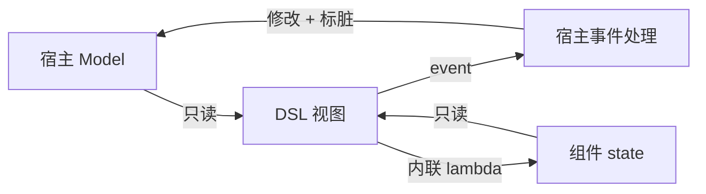
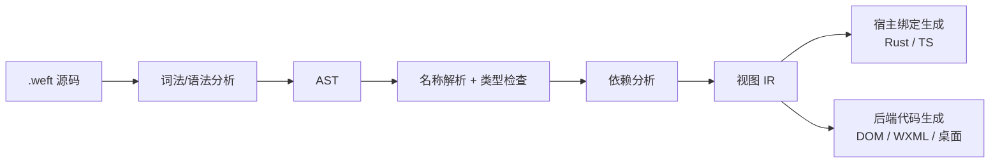

# PLAN

核心理念：用自定义 DSL 描述视图，编译期生成视图代码；状态和业务逻辑交给宿主语言。

借鉴：

- Kotlin：尾随 lambda 风格的声明式 DSL 语法
- Elm：模型与视图解耦，单向数据流，事件驱动更新
- Slint / QtQuick：独立的 UI 描述语言、编译期处理、可嵌入多种宿主语言
- Svelte / SolidJS：编译期依赖分析，不用虚拟 DOM，做细粒度更新

## 目标与非目标

目标：

- **一份 DSL，多个宿主**：同一个 `.weft` 文件可以给 Rust、JS/TS 使用，生成的绑定类型安全。
- **一份 DSL，多个后端**：Web DOM、微信小程序、桌面。
- **编译期完成大部分工作**：类型检查、依赖分析、模板展开都在编译期做，运行时只保留最小的更新逻辑。
- **视图无副作用**：DSL 只能读 `model`，只能改组件私有的 `state`；改 `model` 必须发事件，交给宿主处理。

非目标：

- DSL 不是通用编程语言。不支持函数定义、网络请求、异步，也不会接入宿主的业务库。
- 不追求在所有后端上像素级一致。各后端尽量贴近平台原生表现。
- 第一阶段不做动画系统，也不做复杂布局引擎（Web 和小程序直接用平台布局）。

## 核心概念

| 概念        | 说明                                                   | 谁可以修改          |
| ----------- | ------------------------------------------------------ | ------------------- |
| `model`     | 数据结构声明，编译成宿主语言中的类型                   | 只有宿主            |
| `event`     | 视图向宿主发送的消息，编译成宿主语言中的类型和回调注册 | 由视图发出          |
| `component` | 视图单元，参数是 model 或基础类型，可以嵌套组合        | —                   |
| `state`     | 组件私有的 UI 状态（展开/折叠、hover、输入焦点等）     | 组件内联 lambda     |
| 内置元素    | `Column`、`Row`、`Text`、`Button`、`Input` 等，由后端实现 | —                |

数据流：



## Demo

DSL（`TodoList.weft`）：

```weft
model Todo {
  id: Int,
  name: String,
}

model TodoListModel {
  todos: Todo[],
  draft: String,
}

event TextChanged(value: String)
event Remove(id: Int)

component TodoList(model: TodoListModel) {
  state expanded = false

  Column {
    Input(model.draft, onChange = TextChanged)

    Button(onClick = { expanded = !expanded }) {
      Text(if (expanded) "collapse" else "expand")
    }

    if (expanded) {
      for (todo in model.todos; key = todo.id) {
        Row {
          Text(todo.name)
          Button(onClick = Remove(todo.id)) {
            Text("x")
          }
        }
      }
    }
  }
}
```

要点：

- `onChange = TextChanged`：事件构造器当作函数传入，元素产生的值（输入框文本）用来填充事件参数。
- `onClick = Remove(todo.id)`：直接构造一个事件实例，参数在渲染时绑定。
- `onClick = { ... }`：内联 lambda，**只能修改 `state`**，不能修改 `model`，也不能调用宿主代码。
- `for` 必须指定 `key`，列表 diff 依赖它。
- 视图是表达式树，不支持 `return` 这类提前退出的控制流；条件渲染统一用 `if`/`else`。

宿主（Rust）：

```rust
// build.rs
fn main() {
    weft_ui_compiler::compile("ui/TodoList.weft").unwrap();
}
```

```rust
mod todo_list {
    weft_ui::include_weft!("TodoList");
}

use todo_list::{TodoList, TodoListModel, events};

fn main() {
    let app = TodoList::new(TodoListModel {
        draft: String::new(),
        todos: vec![],
    });

    app.on_text_changed(|model, e: events::TextChanged| {
        model.set_draft(e.value);
    });

    app.on_remove(|model, e: events::Remove| {
        model.todos_mut().retain(|t| t.id != e.id);
    });

    weft_ui::run(app);
}
```

宿主（JavaScript / TypeScript）：

```ts
import { TodoList } from "./TodoList.weft";

const app = new TodoList({ draft: "", todos: [] });

app.onTextChanged((model, e) => {
  model.draft = e.value;
});

app.onRemove((model, e) => {
  model.todos = model.todos.filter((t) => t.id !== e.id);
});

app.mount(document.getElementById("app")!);
```

## 语言设计

### 类型系统

| DSL 类型      | Rust               | TypeScript         |
| ------------- | ------------------ | ------------------ |
| `Int`         | `i64`              | `number`           |
| `Float`       | `f64`              | `number`           |
| `Bool`        | `bool`             | `boolean`          |
| `String`      | `String`           | `string`           |
| `T[]`         | `Vec<T>`           | `T[]`              |
| `T?`          | `Option<T>`        | `T \| null`        |
| `model Foo`   | `struct Foo`       | `interface Foo`    |
| `event Bar`   | `struct events::Bar` | `type Bar`       |

- 第一阶段只做静态类型，不做泛型。
- `state` 的类型由初始值推导，也可以显式标注：`state count: Int = 0`。
- 后续可加 `enum`（带数据的联合类型），映射为 Rust `enum` 和 TS 判别联合。

### 表达式

- 字面量、字段访问 `a.b`、算术、比较、逻辑运算
- 条件表达式 `if (c) a else b`
- 字符串插值 `"共 ${model.todos.length} 项"`
- 内置纯函数的白名单（如 `length`、`isEmpty`、格式化函数），不允许调用宿主函数

### 视图结构

- 元素调用：`Name(位置参数, 命名参数 = 值) { 子节点 }`，子节点块可省略。
- 控制流：`if / else if / else`、`for (x in list; key = expr)`。
- 组件组合：自定义组件和内置元素用法一致，参数类型在编译期检查。
- 插槽：组件可以声明 `children` 参数，接收调用方传入的子节点块。
- 不提供双向绑定。输入类元素一律显式写值和事件，例如 `Input(model.draft, onChange = TextChanged)`，保证 model 只有宿主能改。

### 模块与导入

```weft
import "./models.weft"
import "./components/TodoItem.weft"
```

- `import` 写在文件开头，路径相对当前文件。被导入文件里声明的 `model`、`event`、`component` 全部进入当前文件的作用域，不需要也不支持选择性导入或重命名。
- 导入不传递：A 导入 B、B 导入 C，A 要用 C 的符号必须自己 `import "C.weft"`，避免隐式依赖。
- 从入口文件出发，整个导入闭包共享一个命名空间。任意两个文件声明了同名的 `model`、`event` 或 `component`，都会编译报错，即使它们彼此没有直接导入。这样宿主侧可以把所有符号平铺导出，不需要加前缀。
- 循环导入会编译报错。
- 宿主侧：每个 `.weft` 文件生成一个宿主模块，被多个入口共享的文件只生成一次。入口模块重新导出闭包中的全部符号，宿主只需引用入口模块。

### 样式

- 样式只用命名参数：`Text(todo.name, color = "#333", size = 14)`、`Column(padding = 8, gap = 4)`。
- 每个内置元素声明自己接受的样式参数和类型，编译期检查。后端负责把参数映射到 CSS、WXSS 或桌面渲染属性。
- 样式参数和内置元素一样，只收录所有后端都能实现的参数。
- 需要复用样式时，把元素封装成组件，例如 `component PrimaryButton(label: String)`。不引入 class、选择器或层叠规则。

### 事件

- `event` 在文件级声明，编译成宿主类型和 `on_xxx` / `onXxx` 注册方法。
- 事件统一冒泡到根组件。子组件（包括从其他文件引入的组件）发出的事件，都由根组件实例上的 `on_xxx` 接收。根组件生成的类型包含所有可达组件的事件注册方法。事件名在整个导入闭包内必须唯一（见[模块与导入](#模块与导入)）。
- 同步处理器签名：`(model: &mut Model, event)`。宿主通过生成的 setter / `_mut()` 访问器修改 model，访问时自动标脏。异步处理器见[刷新时机与异步](#刷新时机与异步)。

### 生命周期

生命周期以事件形式暴露给宿主。内置元素和组件调用都接受 `onMount` / `onUnmount` 两个命名参数，值是事件：

```weft
event Loaded
event ItemShown(id: Int)

component TodoList(model: TodoListModel) {
  Column(onMount = Loaded) {
    for (todo in model.todos; key = todo.id) {
      Row(onMount = ItemShown(todo.id)) { Text(todo.name) }
    }
  }
}
```

- `onMount` 在节点插入渲染树之后触发，子节点先于父节点触发。`onUnmount` 在节点移除之前触发。
- `if` / `for` 中的子树每次创建和销毁时都会触发。
- 生命周期事件在一次 flush 内收集，flush 结束后再分发给宿主。处理器修改 model 会触发下一次 flush，不会重入当前这次。

## 编译器架构



- **前端**：手写递归下降解析器。要求错误可恢复（LSP 需要），AST 节点带 span。
- **语义分析**：作用域、类型推导和检查、`state` 只读/可写规则、`for` key 是否存在。
- **依赖分析**：给每个绑定点（文本、属性、条件、列表）计算它读取的 model 字段路径和 state 集合。
- **视图 IR**：与宿主、后端都无关的中间表示。由静态节点树、动态绑定表、更新函数组成。
- **代码生成**：宿主绑定生成和后端生成正交，组合成 `宿主 × 后端` 的产物。
- 编译器本身用 Rust 实现，crate 为 `weft_ui_compiler`。JS 生态（Vite 插件、LSP）以 WASM 形式分发同一个编译器（`wasm-bindgen`）。编译器核心不直接访问文件系统，源码读取和模块解析由宿主侧传入，这样 WASM 和原生两种形态共用一套接口。

## 视图更新

不用虚拟 DOM。编译器从 DSL 静态算出依赖关系，例如“Text 节点 #3 只依赖 `model.count`”，并据此生成精确的更新代码。

1. **字段编号**：给 model 的每个字段和组件的每个 `state` 分配一位，组成脏标记位图（字段多时拆成多个字）。
2. **标脏**：宿主通过生成的 setter 修改 model 时置位；内联 lambda 修改 `state` 时同样置位。
3. **批量更新**：标脏时调度一次 flush，同一轮内的多次修改合并为一次（见下文）。flush 只执行依赖位与脏位有交集的更新函数。
4. **嵌套 model**：字段路径展开为位，例如 `model.user.name` 对应独立的位。列表元素用 `key` 定位，按 key 做最小增删移。
5. **条件分支**：`if` 切换时整体创建或销毁子树；分支内部的绑定只在分支存活时参与更新。

JS 宿主有两种可选方案：生成带 setter 的 model 类，或用 `Proxy` 透明拦截。第一阶段先做生成 setter，行为可预测，也便于调试。

### 刷新时机与异步

刷新由“修改”驱动，和“处理器执行完”无关：

- 每次 setter 标脏时，如果还没有待执行的 flush，就调度一次。JS 用 `queueMicrotask`；Rust 往 UI 事件循环投递一个任务；小程序端合并成一次 `setData`。
- 所以无论修改发生在同步处理器里、`await` 之后，还是定时器回调中，都会自动刷新，宿主不需要手动调用 update。
- 不采用“异步处理器执行完再刷新”的做法，因为它会丢掉中间状态，例如 `loading = true` 要等请求结束才显示。

JS 处理器可以直接写成 `async`：

```ts
app.onSubmit(async (model, e) => {
  model.loading = true; // 本轮微任务刷新
  const todos = await fetchTodos();
  model.todos = todos; // await 之后的修改同样自动刷新
  model.loading = false; // 与上一行合并为一次 flush
});
```

Rust 的 `&mut Model` 不能跨 `.await` 持有，所以异步处理器使用单独的注册方法，参数是 `ModelHandle`：

```rust
app.on_submit_async(|model, e| async move {
    model.update(|m| m.set_loading(true));
    let todos = fetch_todos().await;
    model.update(|m| {
        m.set_todos(todos);
        m.set_loading(false);
    });
});
```

- `ModelHandle` 可克隆，只能在 UI 线程使用（内部是 `Rc`）。借用只在 `update` 闭包内短暂存在，不会跨 `.await`。
- 异步处理器在 UI 线程的本地执行器上运行（`spawn_local`），不要求 `Send`。耗时的计算由宿主自己放到其他线程，完成后再回到 UI 线程调用 `update`。
- 同一事件的多个异步处理器可以并发执行，框架不排队也不取消。结果谁覆盖谁由宿主负责，比如用请求版本号丢弃过期结果。

## 渲染后端

后端在编译器里实现成一个 trait，输入视图 IR，输出目标代码。

| 后端      | 产物                                       | 更新方式                                                            |
| --------- | ------------------------------------------ | ------------------------------------------------------------------- |
| Web       | JS/TS 模块，直接操作 DOM                   | 静态部分用 `<template>` 克隆，动态绑定精确 patch                    |
| 微信小程序 | WXML + WXSS + `Component()` 定义 JS       | 依赖分析结果直接映射为 `setData` 的路径（如 `"todos[3].name"`），减少通信量 |
| 桌面      | Rust 代码，接自绘渲染器（候选：vello / tiny-skia）或原生控件 | 保留模式控件树 + 脏区域重绘                                         |

- 内置元素集合要尽量小，并且在所有后端都能实现。平台特有元素以 `Web.xxx`、`Wx.xxx` 等命名空间区分，在不支持的后端上编译报错。
- 第一阶段桌面端可以先借用 Web 后端跑在 WebView 中，自绘后端放到后期。

## 工具链

- **构建集成**：Rust 用 `build.rs` + `include_weft!` 宏；JS/TS 用 Vite 插件（`.weft` 作为模块导入，同时生成 `.d.ts`）。
- **LSP**：诊断、补全、跳转定义、悬停类型。与编译器共用前端和语义分析。
- **格式化工具**：基于 AST 和注释保留的 `weft fmt`。
- **DSL 解释器**：直接解释视图 IR，用于实时预览和热重载，修改 `.weft` 不需要重新编译宿主。宿主侧事件可以 mock，也可以通过 IPC 转发给正在运行的进程。
- **CLI**：`weft check` / `weft build` / `weft fmt` / `weft preview`。

## 里程碑

| 阶段 | 内容                                                                 | 验收标准                                   |
| ---- | -------------------------------------------------------------------- | ------------------------------------------ |
| M0   | 语法定稿；解析器 + AST + 错误报告                                    | Demo 能解析，错误信息带位置                |
| M1   | 语义分析 + 依赖分析 + 视图 IR                                        | 能输出 Demo 每个绑定点的依赖集合           |
| M2   | TS 宿主绑定 + Web DOM 后端 + Vite 插件                               | Demo 在浏览器中可交互，更新粒度符合预期    |
| M3   | Rust 宿主绑定 + `build.rs` 集成 + WebView 运行                        | Rust 版 Demo 跑通                          |
| M4   | 微信小程序后端                                                       | Demo 在开发者工具中运行，`setData` 只发送变化路径 |
| M5   | LSP + 格式化 + 解释器预览                                            | 编辑器内有诊断和补全，保存后预览热更新     |
| M6   | 桌面自绘后端                                                         | Demo 在原生窗口中运行                      |

